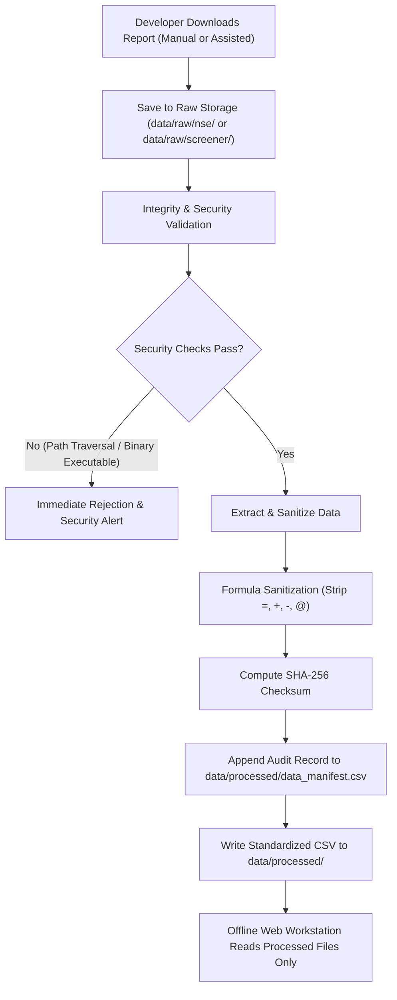

# AlphaWatch AI — Dataset & Data Governance Specification
**ASTRAQUANT X 2026 | Academic Algorithmic Trading Research Platform**

---

## 1. Overview & Architectural Principles

AlphaWatch AI operates on a **100% offline-first, deterministic data architecture**. The web runtime environment executes completely air-gapped from live internet endpoints, never issuing network requests to exchange servers or third-party financial portals. All market intelligence, technical indicators, machine learning inference, and fundamental scores are derived strictly from verified local files with cryptographic provenance tracking.

- **Primary Asset Class:** Indian National Equities (NSE Equity Segment — Series `EQ`)
- **Data Frequency:** Daily End-of-Day (EOD)
- **Runtime Network Dependency:** Zero (`runtime_external_calls = 0`)
- **Execution Boundary:** Academic research and quantitative modeling only; no live order routing or broker connections.

---

## 2. Data Sources & Raw Report Origins

Market and fundamental data are compiled through official public archives using a standalone, offline ingestion utility (`scripts/fetch_data.py`).

| Source Domain | Report Name | Description / Scope | Format | Local Target Directory |
| :--- | :--- | :--- | :--- | :--- |
| **NSE India** | **CM-UDiFF Common Bhavcopy Final** | Daily capital market trading summary covering Open, High, Low, Close, Volume, and VWAP across all traded equities. Sourced from the [NSE All Reports](https://www.nseindia.com/all-reports) portal and [Historical Reports Capital Market Archives](https://www.nseindia.com/resources/historical-reports-capital-market-daily-monthly-archives). | `.zip` containing `.csv` | `data/raw/nse/` |
| **NSE India** | **Security-wise Price, Volume & Delivery** | Historical archive containing security-level traded quantity, deliverable quantity, and institutional delivery percentage (`DeliveryQty`). Sourced from the [NSE Security-wise Archive](https://www.nseindia.com/report-detail/eq_security). | `.csv` | `data/raw/nse/` |
| **NSE India** | **NIFTY 50 Daily Historical Index** | Official benchmark index series for market trend evaluation, beta calculation, and relative alpha assessment. Sourced from [NSE Historical Index Data](https://www.nseindia.com/reports-indices-historical-index-data). | `.csv` | `data/raw/nse/` |
| **NSE India** | **India VIX Daily Historical Data** | Implied volatility index measuring near-term market risk derived from NIFTY index option order books. Sourced from [NSE Historical VIX Data](https://www.nseindia.com/reports-indices-historical-vix). | `.csv` | `data/raw/nse/` |
| **Screener.in** | **Company Financial Workbook** | Comprehensive annual and quarterly balance sheets, P&L statements, cash flows, and capital structure ratios. Exported from individual equity profile pages (e.g. `https://www.screener.in/company/<SYMBOL>/`). | `.xlsx` | `data/raw/screener/` |

---

## 3. Coverage, Symbols & Ingestion Window

```text
[DOWNLOAD DETAILS — USER TO COMPLETE]
Download Date / Ingestion Timestamp : [DOWNLOAD_DATE_PLACEHOLDER e.g., 2026-11-13]
Historical Date Range               : [START_DATE_PLACEHOLDER] to [END_DATE_PLACEHOLDER] (e.g., 2023-01-01 to 2026-10-31)
Total Trading Sessions Recorded     : [TOTAL_SESSIONS_COUNT e.g., 950 Trading Days]
Total Raw Bhavcopy Archives Processed: [COUNT_OF_BHAVCOPY_FILES e.g., 950 zip/csv files]
Manifest Checksum Hash              : [DATA_MANIFEST_SHA256_HASH]
```

### Supported Equity Universe

The initial research universe covers 12 liquid large-cap leaders representing major sectors of the Indian economy:

```text
[LIST_OF_SYMBOLS]:
  - RELIANCE     : Reliance Industries Ltd. (Energy / Oil & Gas / Retail)
  - TCS          : Tata Consultancy Services Ltd. (Information Technology)
  - INFY         : Infosys Ltd. (Information Technology)
  - HDFCBANK     : HDFC Bank Ltd. (Banking & Financial Services)
  - ICICIBANK    : ICICI Bank Ltd. (Banking & Financial Services)
  - SBIN         : State Bank of India (Public Sector Banking)
  - BHARTIARTL   : Bharti Airtel Ltd. (Telecommunications)
  - ITC          : ITC Ltd. (FMCG / Diversified)
  - LT           : Larsen & Toubro Ltd. (Engineering & Infrastructure)
  - HINDUNILVR   : Hindustan Unilever Ltd. (FMCG)
  - BAJFINANCE   : Bajaj Finance Ltd. (Non-Banking Financials / NBFC)
  - MARUTI       : Maruti Suzuki India Ltd. (Automobile)
  [ADDITIONAL_SYMBOLS_PLACEHOLDER: Insert custom research symbols here]
```

---

## 4. Standardized Processed Schema

Raw Bhavcopy entries are filtered strictly for Series `EQ`, sanitized, and mapped to standardized per-symbol CSV files stored in `data/processed/<SYMBOL>.csv`:

| Field Name | Data Type | Unit / Format | Description & Quantitative Role |
| :--- | :--- | :--- | :--- |
| **`Date`** | `DateTime` | `YYYY-MM-DD` | Trading session date (primary chronological index). |
| **`Open`** | `Float64` | Indian Rupee (₹) | First recorded execution price during normal market hours. |
| **`High`** | `Float64` | Indian Rupee (₹) | Intraday peak trade price. |
| **`Low`** | `Float64` | Indian Rupee (₹) | Intraday trough trade price. |
| **`Close`** | `Float64` | Indian Rupee (₹) | Official volume-weighted closing price published by the exchange. |
| **`Volume`** | `Int64` | Number of shares | Cumulative quantity of shares transacted in the session. |
| **`DeliveryQty`** | `Int64` | Number of shares | Quantity of shares marked for physical settlement (demat transfer), excluding intraday speculative square-offs. |

### Derived Feature Pipeline (Zero Lookahead)
All mathematical transformations in `src/features.py` rely exclusively on information available at or before trading day $t$:
- Returns over $1$, $5$, and $20$ trading sessions: $R_{t,k} = \frac{C_t - C_{t-k}}{C_{t-k}}$
- Moving Average Ratios: Percentage distance from 5-day, 20-day, and 50-day SMA and EMA.
- Momentum & Volatility: 14-day Wilder RSI, 20-day historical close-to-close volatility ($\sigma_{20}$).
- Institutional Participation: Delivery Percentage ($\frac{\text{DeliveryQty}}{\text{Volume}} \times 100$) and its 20-day moving average ratio.
- Macro Alignment: Daily NIFTY 50 return and India VIX absolute level and 5-day delta.

---

## 5. Price Adjustment Status & Corporate Action Governance

> [!WARNING]
> **Raw Bhavcopy Price Notice:**  
> National Stock Exchange Bhavcopy files record nominal trade transaction prices. They are **not adjusted for corporate actions** such as stock splits, bonus share issuances, rights issues, or extraordinary dividends.

To prevent unadjusted price drops from producing artificial momentum breakdowns or distorted volatility spikes, AlphaWatch AI enforces automated anomaly detection in `src/data_loader.py`:

1. **The 20% Discontinuity Filter:**  
   Any consecutive daily close price movement exceeding $\pm 20\%$ ($\left|\frac{C_t - C_{t-1}}{C_{t-1}}\right| > 0.20$) is programmatically intercepted and flagged.
2. **Audit Logging & Manual Inspection:**  
   Flagged rows are captured in the system's `ValidationReport` with symbol, date, previous close, current close, and percentage delta. Researchers are alerted to verify the event against official NSE corporate filings before training models or running backtests over the affected window.
3. **Model Shielding:**  
   Large unadjusted jumps are marked so the feature pipeline does not mistake corporate restructuring for authentic price trends.

---

## 6. Trading Calendar, Missing Values & Holiday Handling

Financial time series must reflect genuine exchange trading schedules rather than synthetic interpolation.

- **Market Holidays & Scheduled Closures:**  
  NSE national holidays (e.g., Republic Day, Independence Day, Diwali, Mahashivratri) and regular weekend non-trading days are verified against the NSE official calendar. **AlphaWatch AI never forward-fills or imputes missing prices across scheduled closures.**
- **Trading Halts & Suspensions:**  
  If a trading date is missing from a stock's series while the broader exchange was operational, the system logs an unexplained gap warning. Missing values are left empty (`NaN`) rather than artificially synthesized.
- **Zero-Value & Malformed Data Rejection:**  
  Rows exhibiting non-positive prices ($Open, High, Low, Close \le 0$) or negative volumes are permanently rejected during ingestion.
- **Duplicate De-duplication:**  
  Duplicate records sharing identical `(Date, Symbol)` coordinates are identified, logged, and de-duplicated, keeping the final audited record.

---

## 7. Ingestion Protocol & Cryptographic Integrity Manifest

AlphaWatch AI enforces a strict **Download-Once, Save-Locally** protocol managed through `scripts/fetch_data.py`.



### Security Defenses During Ingestion
1. **Zip-Slip Path Traversal Rejection:** Any archive containing path components with `..`, `/`, or `\` that resolve outside the destination target raises an immediate `ValueError` and is aborted.
2. **Executable Binary Filtering:** Archive contents are screened against executable signatures (`.exe`, `.dll`, `.bat`, `.cmd`, `.sh`, `.vbs`, etc.) to prevent malicious payload execution.
3. **Formula Injection Sanitization:** Screener.in Excel files are parsed using `openpyxl` with `data_only=True` (macros ignored). All text cells starting with `=`, `+`, `-`, or `@` are stripped before persistence to prevent CSV/Excel formula injection.
4. **Data Manifest Ledger:** Every processed raw file is recorded in `data/processed/data_manifest.csv`:
   - `source`: Reporting entity (e.g. `NSE India`, `Screener.in`)
   - `url`: Official source download link
   - `report_name`: Official report title
   - `file_name`: Stored filename
   - `download_date`: Timestamp of ingestion
   - `rows`: Validated record count
   - `date_range`: Temporal coverage (`YYYY-MM-DD to YYYY-MM-DD`)
   - `sha256`: Cryptographic SHA-256 hash for absolute tamper-evidence.

---

## 8. Licences, Terms of Use & Legal Compliance

AlphaWatch AI is developed strictly for **academic, research, and non-commercial educational purposes** in connection with **ASTRAQUANT X 2026**.

- **NSE India Compliance:**  
  Data sourced from NSE India (Bhavcopy reports, historical index data, and volatility series) is utilized in full adherence to NSE terms of service for personal academic research. The platform conducts **zero automated real-time scraping** against NSE servers during web runtime. All files are downloaded offline and archived locally.
- **Screener.in Compliance:**  
  Fundamental workbooks downloaded via Screener.in's "Export to Excel" utility are stored offline under personal fair-use research provisions. The live web workstation makes no automated HTTP/HTTPS requests to Screener.in.
- **Regulatory Status (SEBI):**  
  AlphaWatch AI is **not a SEBI-registered Investment Adviser (RIA)** or Research Analyst (RA). All algorithmic predictions, quantitative metrics, backtests, and fundamental badges constitute academic research simulations and do not represent investment advice, trade recommendations, or financial endorsements.

---

## 9. Methodological Limitations & Known Biases

Researchers utilizing AlphaWatch AI must account for the following analytical boundaries:

1. **Survivorship Bias:**  
   The current supported equity universe is selected from contemporary large-cap leaders (NIFTY 50 constituents). Companies that were historically traded on the exchange but subsequently suspended, liquidated, or delisted during historical intervals are absent from the dataset. Backtested results may consequently exhibit an upward bias compared to an uncurated historical universe.
2. **Unadjusted Dividend & Rights Friction:**  
   Because nominal Bhavcopy prices do not adjust for cash dividends or rights offerings, total-return calculations reflect price return rather than total economic return.
3. **Fundamental Reporting Lag & Stale Data:**  
   Screener.in financial workbooks reflect quarterly and annual filings released 30 to 45 days after fiscal period closes. Between reporting dates, fundamental metrics remain static.
   - **Mandatory 120-Day Stale Warning:** If the elapsed duration since the financial export date exceeds 120 days, the platform displays a prominent warning: `Fundamental data may be outdated (>120 days)`.
4. **Execution Realism vs. Simulated Frictions:**  
   While backtests incorporate realistic Indian market transaction costs (0.10% STT, 0.03% brokerage, GST, exchange fees, SEBI turnover fees, and 5 bps execution slippage at next-day open), simulated fills cannot replicate live order book queue priority or market impact during periods of severe illiquidity.

---

## 10. User Data Storage & Protection Architecture

AlphaWatch AI complies with the data protection principles of the **Indian Digital Personal Data Protection (DPDP) Act** and **GDPR**.

### What User Data is Collected and Stored

The application stores only the minimum personal and portfolio data necessary to provide personalized quantitative analytics:

| Category | Stored Attributes | Database Table | Purpose |
| :--- | :--- | :--- | :--- |
| **Authentication & Identity** | Full Name, Email Address (lowercase, unique), Argon2id Password Hash, Registration Timestamp, Consent Given (`True`). | `users` | Account creation, login authentication, and compliance auditing. |
| **Account Security State** | `failed_login_attempts` (integer), `locked_until` (datetime timestamp). | `users` | Defense against brute-force password guessing; triggers 15-minute lockouts after 5 failed attempts. |
| **Investor Profiler Answers** | Investment goal, horizon, experience level, trading frequency, reaction to 10% fall, savings share invested, preferred sectors, and raw JSON response bundle. | `user_profiles` | Psychometric risk profiling and adaptive questionnaire derivation. |
| **Computed Risk Diagnostics** | Calculated risk score ($0-100$), diversification score, concentration classification, holding style, and explicit *"Why this profile"* derivation rationale. | `user_profiles` | Transparent, deterministic investor classification and candidate ranking. |
| **Portfolio Holdings** | Equity ticker symbol, share quantity, purchase price (₹), optional purchase date. | `holdings` | Portfolio valuation, sector concentration alerts ($>30\%$ stock, $>50\%$ sector), and personalized prediction generation. |
| **Simulated Paper Trades** | Timestamp, ticker symbol, action (`BUY`/`SELL`), executed quantity, simulated price, transaction fees, remaining cash balance, notes. | `paper_trades` | Tracking student simulated trading performance without real capital. |

### How User Data is Protected

1. **Argon2id Cryptographic Password Hashing:**  
   Passwords are never stored in plaintext or reversible encryption. They are hashed using `argon2-cffi` (Argon2id variant) with high memory cost and iteration hardness parameters.
2. **Strict User Data Isolation (Multi-Tenant Isolation):**  
   Every query to the SQLite database incorporates explicit user filtering:  
   `SELECT * FROM holdings WHERE user_id = current_user.id;`  
   Users cannot query, view, or modify data belonging to other registered accounts.
3. **Signed, Ephemeral Session Tokens:**  
   Sessions are managed via cryptographically signed `alphawatch_session` cookies generated with `itsdangerous`. Cookies are flagged `HttpOnly=True` (immune to JavaScript XSS access), `SameSite=Lax` (defends against Cross-Site Request Forgery), and configurable `Secure=True` for HTTPS.
4. **HMAC-SHA256 CSRF Protection:**  
   Every state-altering form (`POST` requests for login, register, onboarding, paper trades, settings) requires a valid cryptographic HMAC-SHA256 CSRF token.
5. **No External Trackers or Telemetry:**  
   The application contains zero Google Analytics, Meta Pixel, external CDN scripts, or third-party web beacons. All assets reside locally in `app/static/`.
6. **Right to Erasure (Cascading Account Deletion):**  
   In compliance with global data protection standards, users can permanently delete their account via the Settings interface. Executing deletion triggers a cascading delete across foreign-key relationships:  
   - The user record is purged.  
   - All associated portfolio holdings are wiped (`ON DELETE CASCADE`).  
   - All profiling answers and risk classifications are wiped.  
   - All simulated paper trading history is wiped.  
   - Session cookies are cleared immediately. Zero orphaned data remains in the database.
